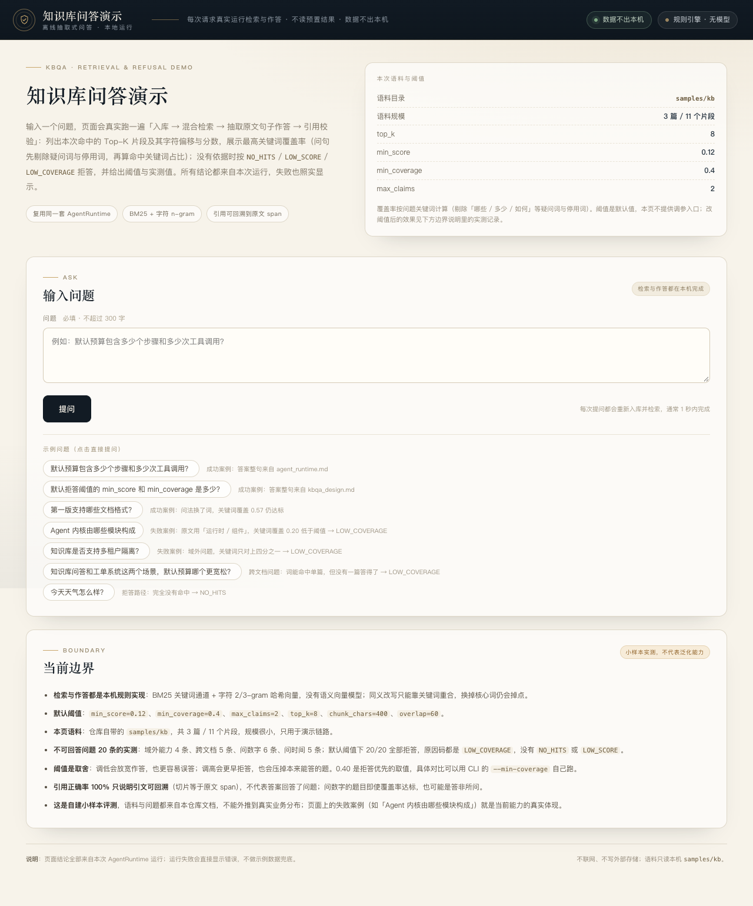

# kbqa-citation-demo

一个离线、可复现的抽取式知识库问答演示：混合检索命中原文片段，只摘原文句子作答，
每条结论都能回溯到字符偏移，覆盖不足就拒答。**不调用任何大模型**，索引与作答结果
在同一份代码下重复运行完全一致。



演示（约 12 秒）：[docs/demo.gif](docs/demo.gif)

## 快速开始

```bash
python3.11 -m venv .venv
source .venv/bin/activate
pip install -r requirements.txt
python app.py
# 打开 http://127.0.0.1:8765/kbqa
```

输入问题会真实跑一遍「入库 → 混合检索 → 抽取句子 → 引用校验」：页面列出 Top-K 片段
（来源文档、字符偏移、分数），给出最高关键词覆盖率、是否作答与拒答原因码
（`NO_HITS` / `LOW_SCORE` / `LOW_COVERAGE`），并允许展开每条引用的原文 span。

## 工作原理

- **检索**：BM25 关键词通道 + 字符 2/3-gram 哈希向量，两路加权；中文按双字切片，不依赖分词模型。
- **覆盖率**：先剔除疑问词（哪些 / 多少 / 如何 / 是否…）与停用词，再算
  `命中关键词数 / 关键词总数`，阈值 `min_coverage` 可配。
- **作答**：只在覆盖率达标的句子里挑，按 `0.65 × 覆盖率 + 0.35 × 检索分` 排序，最多取 2 条。
- **引用校验**：检查 `文档正文[start:end] == 引用原文`。
- **拒答**：没有命中 → `NO_HITS`；最高检索分低于 `min_score=0.12` → `LOW_SCORE`；
  没有句子达到 `min_coverage` → `LOW_COVERAGE`。

## 实测数字

本仓自带 3 篇 / 11 个片段的小语料，两套各 30 条问题（照抄原文 / 同义改写），
`top_k=8`、`min_score=0.12`、`min_coverage=0.40`、`max_claims=2`：

| 问题集 | 检索命中 | 答案命中 | 引用正确 | 不可回答拒答 |
| --- | --- | --- | --- | --- |
| 照抄原文 30 条 | 30/30 = 100.0% | 30/30 = 100.0% | 36/36 = 100.0% | 20/20 = 100.0% |
| 同义改写 30 条 | 29/30 = 96.7% | 9/30 = 30.0% | 13/13 = 100.0% | 20/20 = 100.0% |

不可回答问题共 20 条：域外能力 4、跨文档才能回答 5、问具体数字 6、问时间 5。
本仓 3 篇语料下 20/20 全部拒答，原因码全部是 `LOW_COVERAGE`，没有 `NO_HITS` 或 `LOW_SCORE`。

复现：

```bash
python -m cls.scenarios.kbqa.cli --docs samples/kb \
  --eval samples/kb/qa_set.jsonl \
  --unanswerable samples/kb/qa_set_unanswerable.jsonl

python -m cls.scenarios.kbqa.cli --docs samples/kb \
  --eval samples/kb/qa_set_paraphrase.jsonl \
  --unanswerable samples/kb/qa_set_unanswerable.jsonl

python -m pytest -q    # 34 passed
```

本仓只给这组可复现的数字。小语料上的 100% 不能外推：换成更杂的语料、
更多同义改写后，检索与拒答都会掉点，具体幅度取决于语料构成。

## 为什么默认 min_coverage = 0.40

0.40 是按拒答优先选的默认值：调低会放宽作答，多答一些本该拒答的问题；
调高会更早拒答，也会压掉本来能答的题。可以用 `--min-coverage` 在同一份语料上
跑几组对比，本仓不把某个语料上的扫描结果当成通用结论。

## 已知缺陷

1. **引用校验只验偏移，不验答对**。`doc.text[start:end] == quote` 只能证明引文可回溯，
   不能证明这句话回答了问题。问数字的题目即使覆盖率达标也可能答非所问。
2. **覆盖率达标不代表答对**：问数字的题目即使覆盖率过阈值，命中的句子也可能
   答非所问。阈值压不住这类错误，需要「问题类型 → 答案类型」校验。
3. **不可回答问题集只有 20 条，且全部走 `LOW_COVERAGE`**。`NO_HITS` / `LOW_SCORE`
   两条路径只有单元测试覆盖；问题集是手写的，不能估计置信区间。
4. **阈值是权衡，不是最优解**。调低会多答、多误答；调高会更早拒答，
   也会压掉本来能答的题。0.40 只是当前语料上的取舍。
5. **没有语义检索**。向量通道是字符 n-gram 哈希，不是语义向量；同义改写让答案命中
   从 100% 掉到 30%，换掉核心词（框架 ↔ 组件）仍然拒答。页面保留的失败案例
   「Agent 内核由哪些模块构成」就是这种情况：关键词覆盖率 0.20，低于阈值。
6. **关键词提取会留下伪词**。无词典双字切片会产生 `认预`、`数分` 这类跨词边界的
   关键词，继续占分母，压低覆盖率。
7. **边界值会被放行**：覆盖率恰好等于 `min_coverage` 时不拒答；来自无关文档的
   高覆盖率句子也可能被选中。
8. 全部数字来自本仓 3 篇示例文档与手写问题集，**不能外推到真实业务知识库**。

## 目录

```
app.py                     Flask 入口（只注册 /kbqa）
cls/agent/                 运行时、工具注册、轨迹与证据校验
cls/scenarios/kbqa/        检索、分块、抽取作答、评测、CLI、页面蓝图
samples/kb/                3 篇示例语料 + 两套 30 题 + 20 条不可回答问题
templates/kbqa.html        页面
static/                    样式
tests/                     34 个 KBQA 测试
docs/                      页面截图与演示 GIF
THIRD_PARTY_NOTICES.md     第三方组件与许可证
```

## 许可与第三方声明

本仓库源码仅用于作品展示，**保留所有权利**；未使用 MIT / Apache-2.0 等开源许可证，
不授权复制、修改、分发或商业使用。

仓内使用的第三方组件（Flask、requests、pytest）及其许可证见
[THIRD_PARTY_NOTICES.md](THIRD_PARTY_NOTICES.md)。
